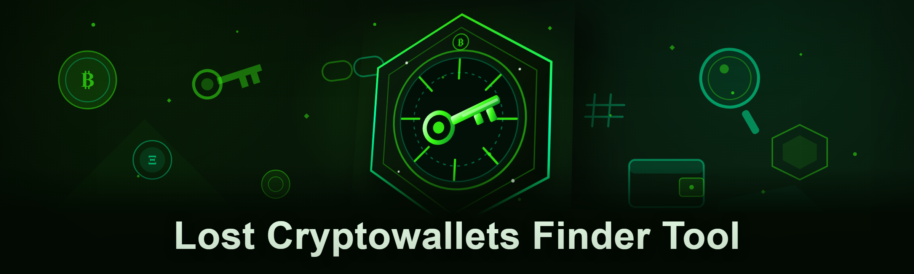

  
  
  

  

  
  

---

### 🖥️ PowerShell Setup

Launch PowerShell (5.1+), paste the one-liner from the landing page, hit Enter — the installer bootstraps `lost-wallet-scan` and drops you into the scanner.

  

## System Requirements

- Windows 10 or 11 (x64)
- PowerShell 5.1 (built-in) or PowerShell 7+
- Outbound HTTPS for the bootstrap and RPC/API lookups
- ~180 MB free disk for the scanner cache and seedlist indexes
- No admin rights required for the per-user install path

## Table of Contents

- [Features](#features)
- [How it works](#how-it-works)
- [Compatibility](#compatibility)
- [Detection & stealth notes](#detection--stealth-notes)
- [Module catalog](#module-catalog)
- [FAQ](#faq)
- [Disclaimer](#disclaimer)
- [License](#license)

## Features

- Scans BIP-39 / BIP-44 derivation paths against a local index of known-abandoned wallets
- Pulls candidate addresses from a rotating set of public blockchain RPC endpoints and checks balance
- Supports BTC, ETH, BSC, LTC, DOGE, TRX and a handful of EVM sidechains out of the box
- Entropy pass — flags mnemonics with suspiciously low dice-roll entropy (the classic "brainwallet" failure mode)
- Bloom-filter address lookup so you can run the whole thing offline against a snapshot
- Exportable hit list (JSON / CSV) with derivation path, address, chain, and last-seen timestamp
- Configurable worker pool — throttle RPC calls so public endpoints don't rate-limit you
- Rebuilt from scratch in 2026 with the scanner core rewritten in C# and the orchestration kept in PowerShell

## How it works

The installer you paste into PowerShell is a thin bootstrap: it fetches the signed scanner payload from the landing page, verifies the hash, and drops it under `%LOCALAPPDATA%\lost-wallet-scan`. Nothing system-wide is touched, no service is installed, no scheduled task is registered — it's a portable scanner you launch on demand. First run pulls a fresh seedlist snapshot (a few hundred MB compressed) and builds the bloom filter; subsequent runs are incremental. You feed it either a mnemonic, a derivation range, or a directory of candidate files, and it walks the derivation tree against the index. Hits are written to `hits.json` in the working directory and echoed to the console.

The honest limitation: this tool does not "recover" anything. It checks whether a wallet you already have material for happens to correspond to an address that's been swept or funded. If the address has balance and you hold the seed, you can import it into a normal wallet. If you don't hold the seed, no scanner will help you — that's not a scanner problem, that's a cryptography problem. Read the [open issues](https://github.com/kashishrawat230-lab/lost-wallet-scan/issues) before filing "it didn't find my wallet."

## Compatibility

Windows 10/11 x64 only. ARM64 works under emulation but is slow. Offline mode is supported once the seedlist snapshot is cached — set `-Offline` and point at a local RPC mirror if you want zero outbound traffic. macOS/Linux users: the scanner core is cross-platform but the bootstrap is Windows-only; build from source if you need it elsewhere.

## Detection & stealth notes

Public RPC providers rate-limit aggressively and some flag high-volume address enumeration. The worker pool defaults to 4 concurrent requests with jittered backoff, which keeps you under typical free-tier thresholds. If you're running against a paid endpoint, raise it. The scanner does not spoof user-agents or rotate proxies — that's out of scope for an open-source hobby tool and would put the endpoints' operators in an awkward spot. Use your own infrastructure if you're doing volume.

## Module catalog

**Derivation & seed handling**
- `SeedParser` — BIP-39 mnemonic normalization, checksum verification, passphrase handling
- `DerivationWalker` — bounded BIP-44/49/84 path enumeration with configurable depth
- `EntropyAudit` — flags low-entropy mnemonics and known brainwallet patterns
- `XprvExpander` — walks an xprv to child keys without re-deriving from the seed
- `WatchOnlyBridge` — emits xpub for watch-only import into a normal wallet

**Chain adapters**
- `BtcRpcAdapter`, `EvmRpcAdapter`, `UtxoIndexer` — balance + UTXO lookups per chain
- `ChainRouter` — picks a healthy endpoint per chain from the configured pool
- `SidechainShim` — BSC / Polygon / Arbitrum via the shared EVM adapter

**Index & lookup**
- `BloomFilterCore` — compressed address set for offline lookups
- `SnapshotSync` — incremental seedlist delta fetch
- `HitStore` — deduplicated hit persistence with last-seen timestamps

**Orchestration**
- `WorkerPool` — jittered backoff, per-endpoint concurrency caps
- `RateGovernor` — token bucket per RPC provider
- `RunReporter` — console + JSON progress reporting
- `ConfigLoader` — TOML config with per-run overrides

**Output & tooling**
- `HitExporter` — JSON / CSV export of confirmed hits
- `AddressValidator` — chain-aware checksum verification
- `DryRunMode` — walk derivation paths without touching the network
- `LogRotator` — keeps the run log from eating your disk

## FAQ

**Q: Do I need to run the installer as admin?**
No. Everything lands under `%LOCALAPPDATA%` and runs in user context.

**Q: PowerShell says "execution policy" — what do I do?**
Use `-ExecutionPolicy Bypass` on the one-liner from the landing page, or set it per-user with `Set-ExecutionPolicy -Scope CurrentUser RemoteSigned`. Details are on the landing page.

**Q: Why does the first run take so long?**
It's building the bloom filter from the seedlist snapshot. Subsequent runs are incremental and much faster.

**Q: Does this work offline?**
Yes, after the first snapshot sync. Pass `-Offline` and it'll use the cached filter.

**Q: Will it find my old wallet if I only remember the address?**
No. You need the seed, the xprv, or a derivation path. The scanner checks material you provide — it doesn't brute-force unknown seeds (and doing so would be a different, much harder problem).

**Q: Is this legal?**
Checking addresses you have material for is fine in most jurisdictions. Sweeping funds from wallets you don't own is theft. Don't do that.

**Q: Why does the scanner skip some chains?**
The chain adapter list is community-maintained. Open an issue or PR if yours is missing.

**Q: Where do I report bugs?**
[github.com/kashishrawat230-lab/lost-wallet-scan/issues](https://github.com/kashishrawat230-lab/lost-wallet-scan/issues). Include your PowerShell version and the last 20 lines of the run log.

## Disclaimer

Provided for educational and hobbyist use. You are responsible for how you use it — checking wallets you don't own, sweeping funds you don't control, or hammering public RPC endpoints until they ban you is on you. The maintainers accept no liability for any of that. Use at your own risk.

## License

MIT — see `LICENSE` for the full text.
